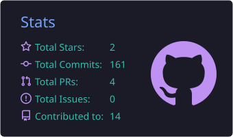
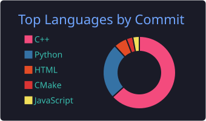

<h1 align="center">Arpan Chauhan</h1>

  

<!-- 

  

 -->

## 👋 about

I do what I love to do. Mostly that means building things that go deep.

- 🛠️ Building: anything deep, mostly in C++ and Python
- 🔭 Looking up: always
- 🧭 Exploring: finding funds and time to travel, new places, new ideas
- 🎓 B.Tech CSE, Jaypee University of Information Technology (2025)

---

## 🚀 projects

### 🔵 Constella + Constella Lens
Distributed key-value store (C++17): consistent hashing (150 virtual nodes), quorum replication, WAL persistence, 4-byte TCP framing, TTL-based dedup, Docker deployment.
On top of it, **Constella Lens**: semantic log intelligence with `all-MiniLM-L6-v2`, Pinecone and a Flask API with a terminal-style UI.

`C++17` `POSIX Sockets` `Consistent Hashing` `Python` `Sentence Transformers` `Pinecone` `Docker`

### 🪐 Solaris: N-body Gravity Simulator
Real-time N-body orbital mechanics with Barnes-Hut tree approximation, physically accurate gravity and raylib rendering.

`C++17` `raylib` `Barnes-Hut` `Physics Simulation`

---

## 🧰 stack

| | |
|---|---|
| **Languages** | C++17 · Python · JavaScript |
| **Backend** | Flask · FastAPI · Microsoft Graph API |
| **Frontend** | React.js · Three.js |
| **AI / ML** | LLMs · Fine-tuning · QLoRA / PEFT · AI Agents / Agentic Workflows · Sentence Transformers · Pinecone |
| **Databases** | PostgreSQL |
| **DevOps** | Azure DevOps Services · CI/CD · Docker |
| **Low-level / C++** | POSIX Sockets · Distributed Systems · Consistent Hashing · Quorum Replication · Write-Ahead Log |

---

## 📊 stats

  
  

---

## 📬 contact

  
  
  

