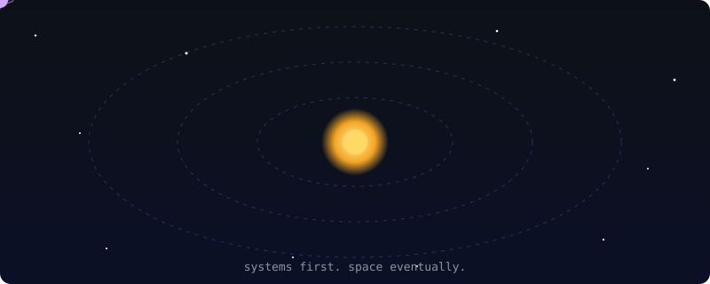

<h1 align="center">Arpan Chauhan</h1>

  

  

---

## 🧑‍🚀 mission briefing

Software developer building LLM tooling, low-latency C++ systems, and whatever is interesting enough to build.

- 🎓 B.Tech CSE, Jaypee University of Information Technology (2025)
- 🧮 700+ DSA problems, C++17 and systems background
- 🔭 Long-term trajectory: space and low-latency infrastructure

---

## 🚀 missions

### 🛰️ Constella + Constella Lens
Distributed key-value store (C++17): consistent hashing (150 virtual nodes), quorum replication, WAL persistence, 4-byte TCP framing, TTL-based dedup, Docker deployment.
On top of it, **Constella Lens**: semantic log intelligence with `all-MiniLM-L6-v2`, Pinecone and a Flask API with a terminal-style UI.

`C++17` `POSIX Sockets` `Consistent Hashing` `Python` `Sentence Transformers` `Pinecone` `Docker`

### 🪐 Solaris: N-body Gravity Simulator
Real-time N-body orbital mechanics with Barnes-Hut tree approximation, physically accurate gravity and raylib rendering.

`C++17` `raylib` `Barnes-Hut` `Physics Simulation`

---

## 🧰 flight instruments

| Subsystem | Tools |
|---|---|
| **Languages** | C++17 · Python · JavaScript / TypeScript |
| **Backend** | Flask · FastAPI · Node.js |
| **Frontend** | React · HTML/CSS |
| **AI / ML** | Sentence Transformers · Pinecone · LaBSE · Gemini API |
| **Systems** | POSIX Sockets · Docker · WAL · Consistent Hashing |
| **Databases** | PostgreSQL · Supabase · SQLite |

---

## 📡 telemetry

  
  

---

## 🌌 current trajectory

- 🤖 **Now:** targeting AI/ML roles, learning and building
- 🛰️ **Next:** systems roles in space / HFT / low-latency infra
- 🔭 **Always:** looking up

---

## 📬 open a channel

  
  
  

